

  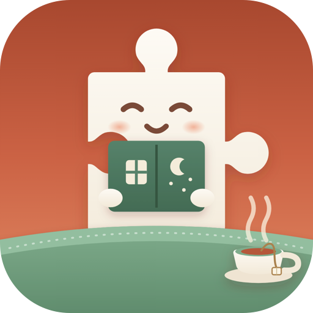

# Piece of Mind: Picture Puzzles

  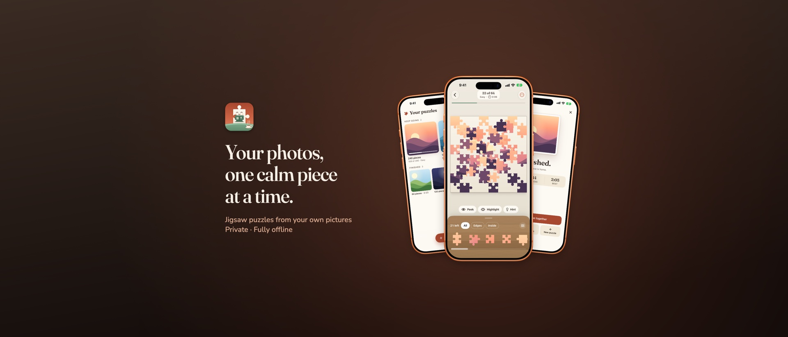

  

A calm iOS jigsaw app built around your own photos. Pick a picture, choose how many pieces, and put it back together — piece by piece — with a soft snap and a little sparkle. Play relaxed with no clock at all, or turn on a timed mode when you want a challenge. Everything runs on device: no accounts, no network, no ads, no subscription.

## Screenshots

### iPhone

  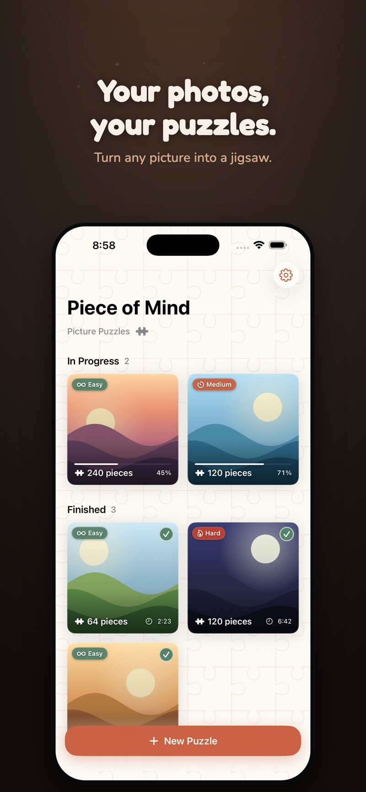
  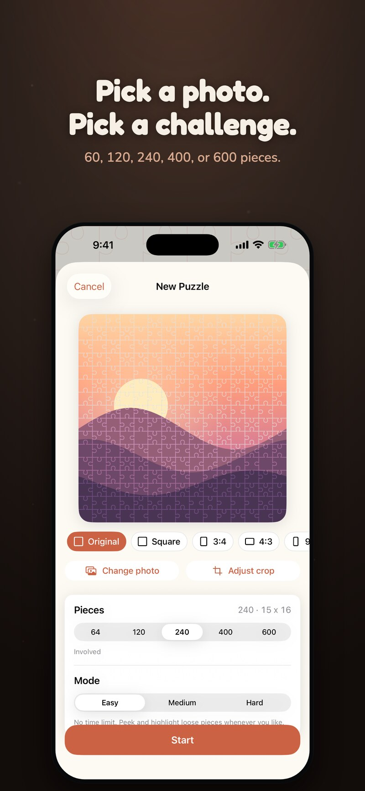
  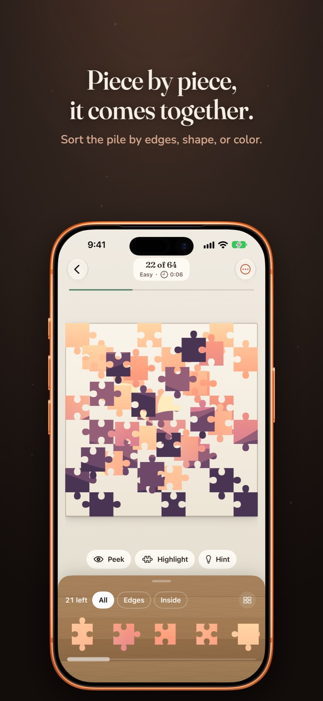
  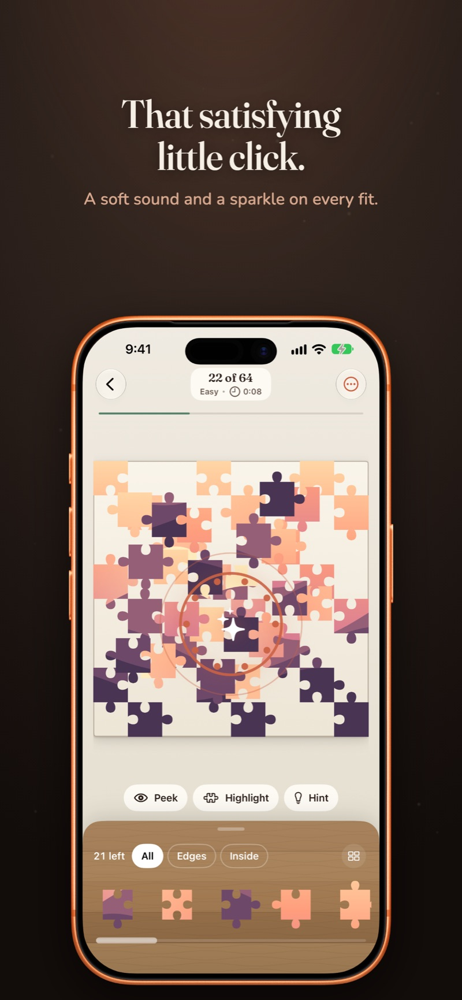
  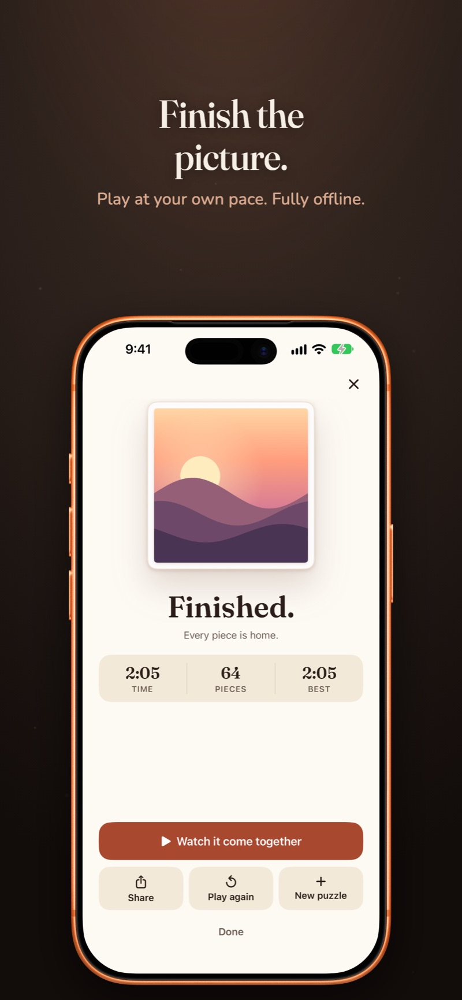

### iPad

  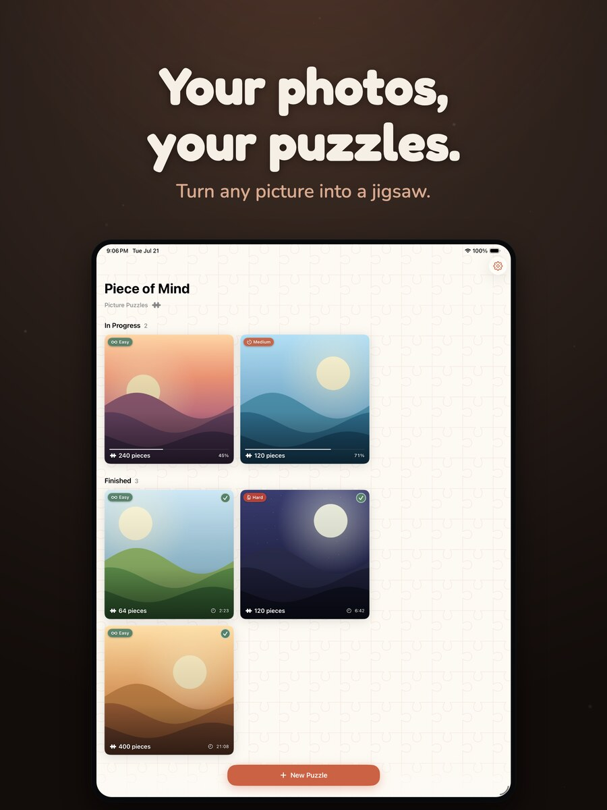
  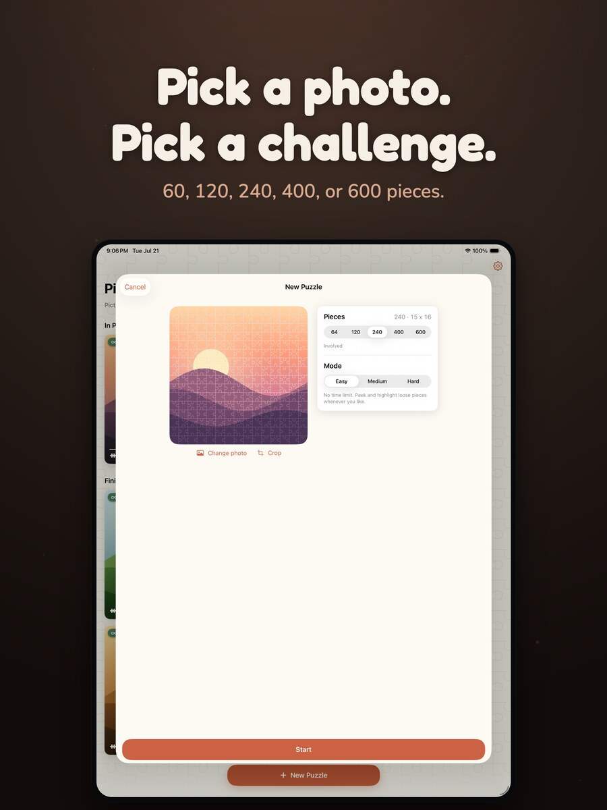
  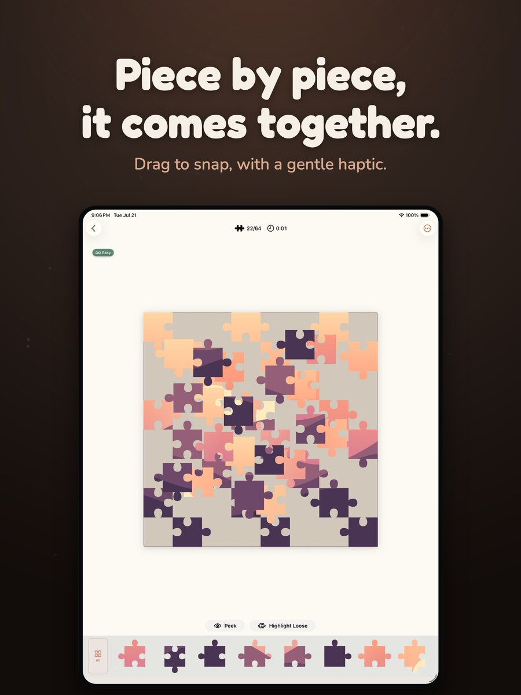
  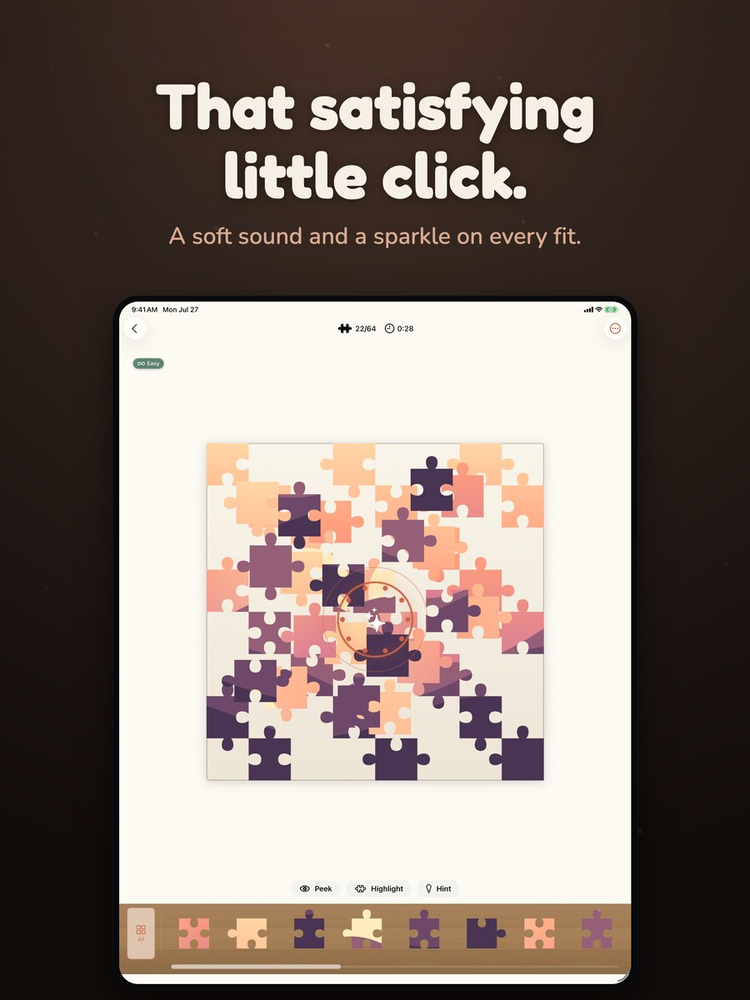
  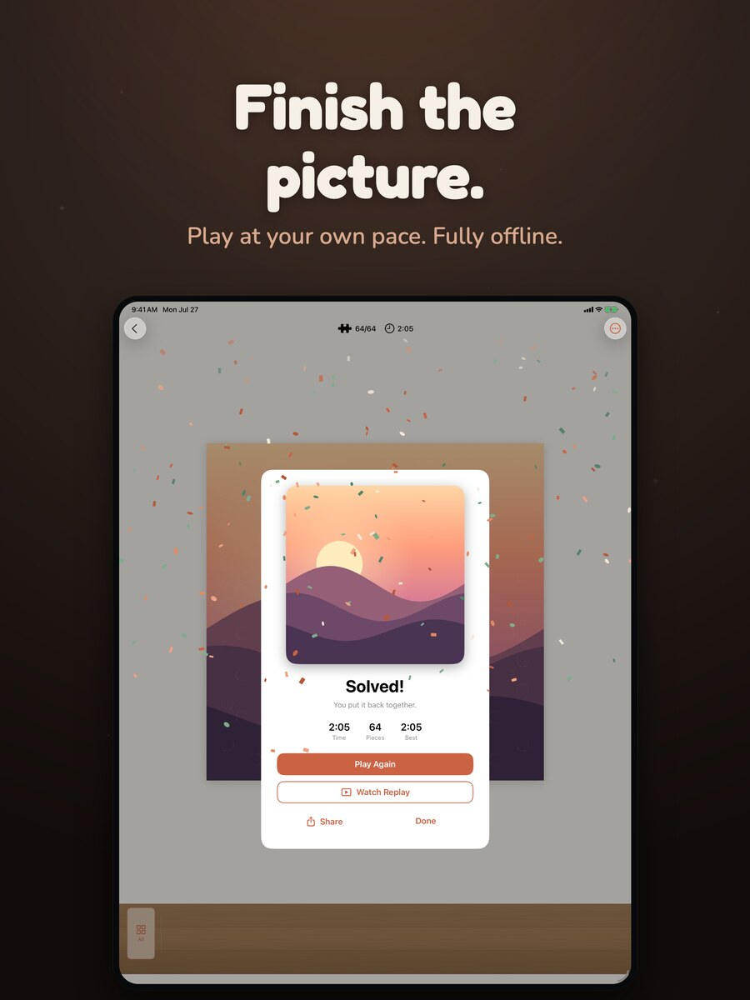

### iPhone Duo

Unfold it and the app opens up across the fold, with the picture on one side and your controls on the other.

  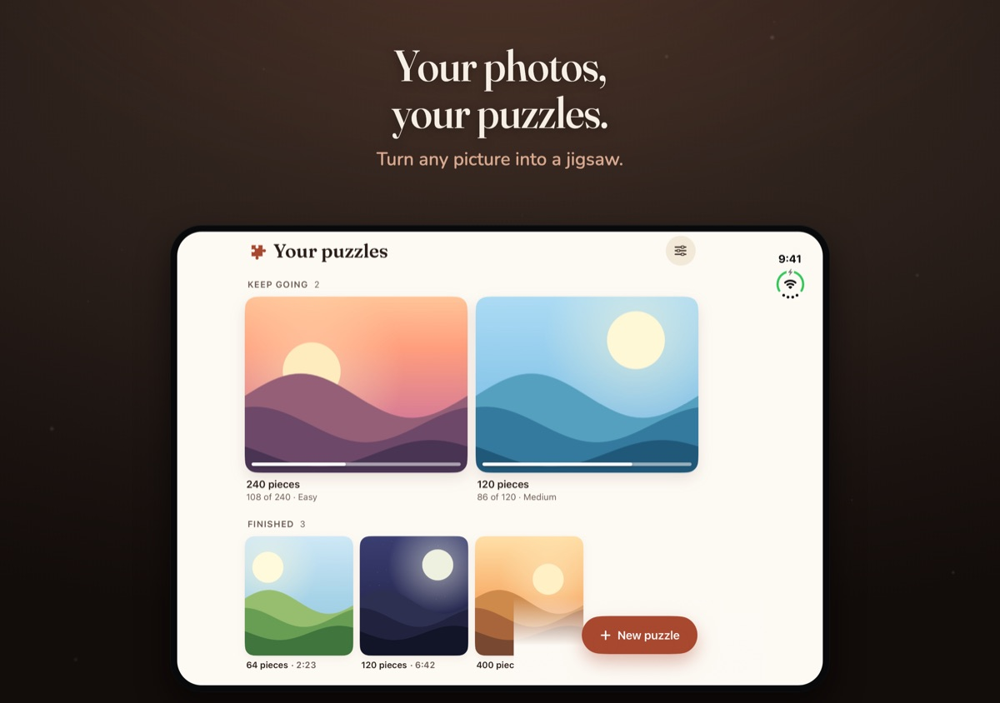
  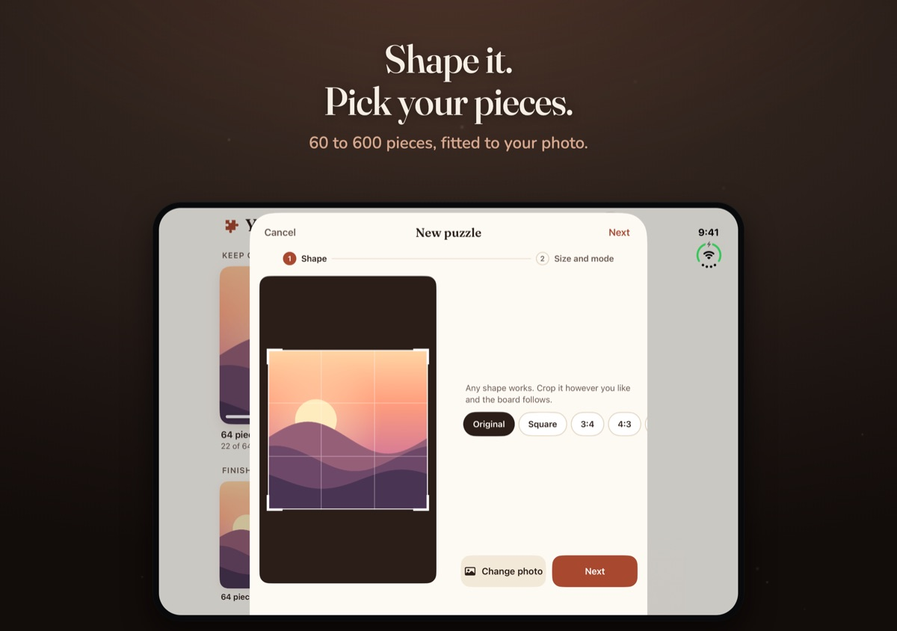
  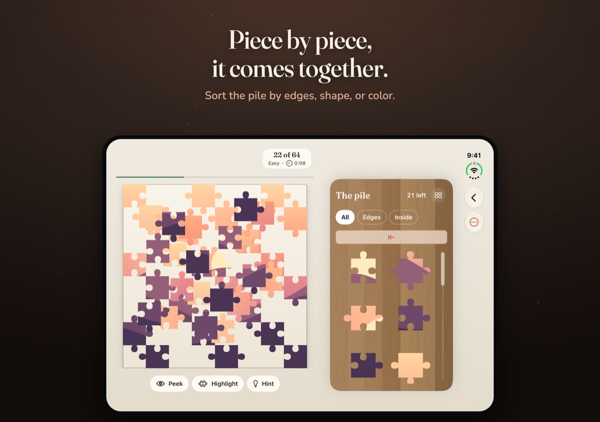
  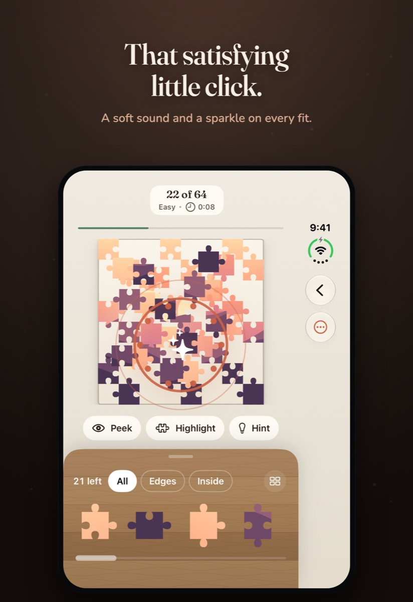
  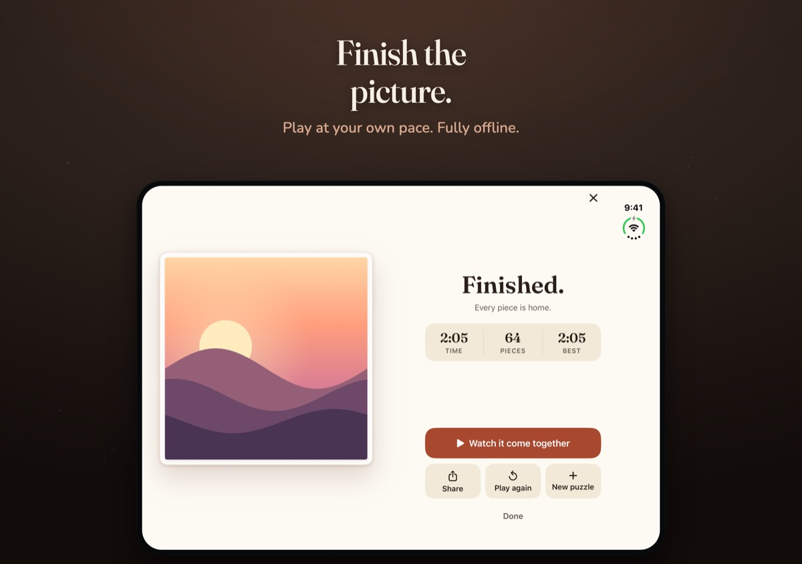

## What's New in 2.0

- A fresh new look throughout, with warmer colors and a new serif for headings.
- A friendlier welcome: choose your favorite puzzle size and mode, and try placing a piece before you start.
- Sort the pile: show only edge or inside pieces, or pull up the tray to group every loose piece by shape or by color.
- New puzzles take two quick steps: shape your photo, then pick a size and mode with a live preview of the cut.
- A new finished screen, a redesigned library and settings, and a smoother replay with a scrubber you can drag.
- On iPad, the pile sits in a roomy side panel next to the board.
- Made for iPhone Duo: unfold it and the main screens open up across the fold.

## How to Play

- **Pick a photo** from your library (or start with the sample puzzle), **shape** it to the shape you like, then choose a piece count and a mode with a live preview of the cut.
- A blade **sweeps your photo along the real seams** while the puzzle is cut, and then the board is laid out with a faint **reference ghost** behind it.
- Pieces wait in a scrolling **pile** at the bottom, with a **scrub bar** for travelling a long pile quickly. Narrow it to **edge** or **inside** pieces, or pull it up to see every loose piece **grouped by shape or by color**.
- **Tap** a piece to send it to the board, then **drag** it to its spot. When it lands, it **snaps** into place with a sparkle and a gentle haptic. Neighboring pieces **join into clusters** that move together. **Pinch to zoom** in on a tricky corner.
- Play **Easy** with no clock and the on-board aids available — **Peek** at the picture, **Highlight** the loose pieces, or ask for a **Hint** — or pick a **timed** mode, which hides the aids and puts the solve on a countdown scaled to the puzzle's size.
- The bar tracks your progress and time, a quiet word marks the milestones along the way (the frame closing, the halfway mark, the home stretch), and finishing the picture brings a celebration.

## Piece Counts

Difficulty is simply how many pieces you want: **60**, **120**, **240**, **400**, or **600**. The grid **adapts to each photo's aspect ratio**, so a wide landscape and a tall portrait each get a layout that lands near your chosen count while keeping pieces pleasantly square.

Every puzzle is generated deterministically from the source photo, so a puzzle you resume looks exactly as it did when you started it.

## Features

- **Your photos, your puzzles** — turn any picture from your library into a jigsaw, shaped the way you like, or start with the built-in sample
- **Five piece counts** — 60 / 120 / 240 / 400 / 600, with the grid fit to each photo's shape
- **Easy, Medium, and Hard modes** — play untimed and relaxed, or against a countdown that scales to the puzzle's size
- A **reference ghost** behind the board plus **Peek**, **Highlight loose**, and **Hint**, so help is one tap away in Easy mode (and switched off entirely in the timed modes)
- **Clustered pieces** — snap neighbors together and move them as one, plus **pinch to zoom** for the fiddly bits
- **Sort the pile** — filter to edge or inside pieces, or group every loose piece by shape or by color, plus a **scrub bar** for long piles
- **Tap to place, drag to snap** — satisfying snap feedback with sparkles and haptics
- **A word along the way** — the app marks the frame closing, the quarter marks, and the home stretch
- **Progress and elapsed time** in the bar, and a **best time** on each puzzle's Home card
- **Watch it come together** — record a solve and replay it, or export it as a shareable video
- **Resume anytime** — piece positions, clusters, tray order, and elapsed time persist, so you can close mid-puzzle and pick up later
- **Share the finished image** from the completion screen or the Home long-press menu
- **Make it yours** — pick the surface under the board and the wood behind the tray, choose light or dark, and on iPad keep the pile in a side panel next to the board
- A friendly first-run **welcome** that sets your favorite size and mode, soft snap and completion sounds, and a **calm music bed** while you solve
- Independent **sound effects, music, and haptics** toggles
- Universal (**iPhone + iPad**), with two-pane layouts on the unfolded **iPhone Duo**
- Fully **offline** — no account, no sign-up, no ads, no analytics, no network calls

## Privacy

Piece of Mind does not collect or share any of your personal data. There are no ads, no analytics, and no accounts. Your photos and puzzles stay on your device. See our full [Privacy Policy](PRIVACY.md).

## Support

Have a question or found a bug? Check our [Support & FAQ](SUPPORT.md) page or [open an issue](https://github.com/idevtim/piece-of-mind/issues).

## Requirements

- iOS 18.0+
- iPhone (including iPhone Duo) and iPad

## License

All rights reserved.
