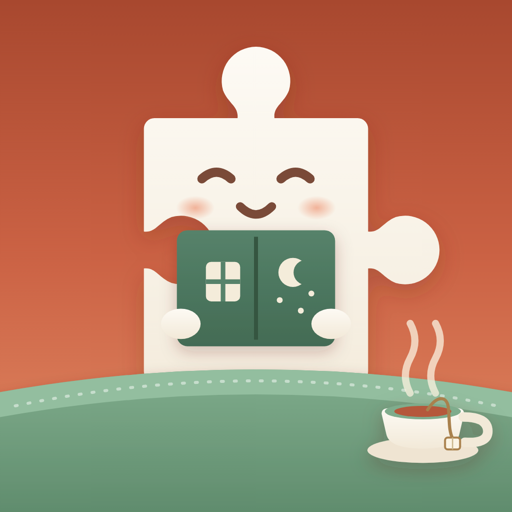

  

# Piece of Mind: Picture Puzzles

<!-- App Store link goes here once the app ships:

  <a href="APP_STORE_URL"><strong>Download on the App Store →</strong></a>

-->

A calm iOS jigsaw app built around your own photos. Pick a picture, choose how many pieces, and put it back together — piece by piece — with a soft snap and a little sparkle. Play relaxed with no clock at all, or turn on a timed mode when you want a challenge. Everything runs on device: no accounts, no network, no ads, no subscription.

> **Status:** In development, not yet on the App Store. A download link will be added here at launch.

## Screenshots

### iPhone

  
  
  
  
  

### iPad

  
  
  
  
  

## How to Play

- **Pick a photo** from your library (or take one), **crop** it to the shape you like, then choose a piece count and a mode.
- A blade **sweeps your photo along the real seams** while the puzzle is cut, and then the board is laid out with a faint **reference ghost** behind it.
- Pieces wait in a scrolling **tray** at the bottom, with a **scrub bar** for travelling a long pile quickly and a **view-all gallery** when you want to see them all at once.
- **Tap** a piece to send it to the board, then **drag** it to its spot. When it lands, it **snaps** into place with a sparkle and a gentle haptic. Neighboring pieces **join into clusters** that move together. **Pinch to zoom** in on a tricky corner.
- Play **Easy** with no clock and the on-board aids available — **Peek** at the picture, **Highlight** the loose pieces, or ask for a **Hint** — or pick a **timed** mode, which hides the aids and puts the solve on a countdown scaled to the puzzle's size.
- The bar tracks your progress and time, a quiet word marks the milestones along the way (the frame closing, the halfway mark, the home stretch), and finishing the picture brings a celebration.

## Piece Counts

Difficulty is simply how many pieces you want: **60**, **120**, **240**, **400**, or **600**. The grid **adapts to each photo's aspect ratio**, so a wide landscape and a tall portrait each get a layout that lands near your chosen count while keeping pieces pleasantly square.

Every puzzle is generated deterministically from the source photo, so a puzzle you resume looks exactly as it did when you started it.

## Features

- **Your photos, your puzzles** — turn any picture from your library (or a fresh camera shot) into a jigsaw, and crop it first if you like
- **Five piece counts** — 60 / 120 / 240 / 400 / 600, with the grid fit to each photo's shape
- **Easy, Medium, and Hard modes** — play untimed and relaxed, or against a countdown that scales to the puzzle's size
- A **reference ghost** behind the board plus **Peek**, **Highlight loose**, and **Hint**, so help is one tap away in Easy mode (and switched off entirely in the timed modes)
- **Clustered pieces** — snap neighbors together and move them as one, plus **pinch to zoom** for the fiddly bits
- A scrolling **piece tray** with a **scrub bar** for long piles, and a **view-all gallery** for finding the piece you want
- **Tap to place, drag to snap** — satisfying snap feedback with sparkles and haptics
- **A word along the way** — the app marks the frame closing, the quarter marks, and the home stretch
- **Progress and elapsed time** in the bar, and a **best time** on each puzzle's Home card
- **Watch it come together** — record a solve and replay it, or export it as a shareable video
- **Resume anytime** — piece positions, clusters, tray order, and elapsed time persist, so you can close mid-puzzle and pick up later
- **Share the finished image** from the completion screen or the Home long-press menu
- **Make it yours** — pick the surface under the board and the wood behind the tray, choose light or dark, and on iPad put the tray column under your dominant hand
- First-run **onboarding**, soft snap and completion sounds, and a **calm music bed** while you solve
- Independent **sound effects, music, and haptics** toggles
- Universal (**iPhone + iPad**)
- Fully **offline** — no account, no sign-up, no ads, no analytics, no network calls

## Privacy

Piece of Mind does not collect or share any of your personal data. There are no ads, no analytics, and no accounts. Your photos and puzzles stay on your device. See our full [Privacy Policy](PRIVACY.md).

## Support

Have a question or found a bug? Check our [Support & FAQ](SUPPORT.md) page or [open an issue](https://github.com/idevtim/piece-of-mind/issues).

## Requirements

- iOS 18.0+
- iPhone and iPad

## License

All rights reserved.
